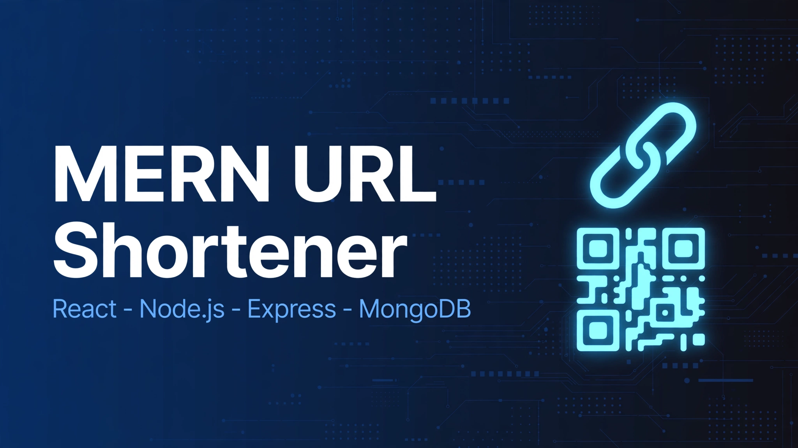
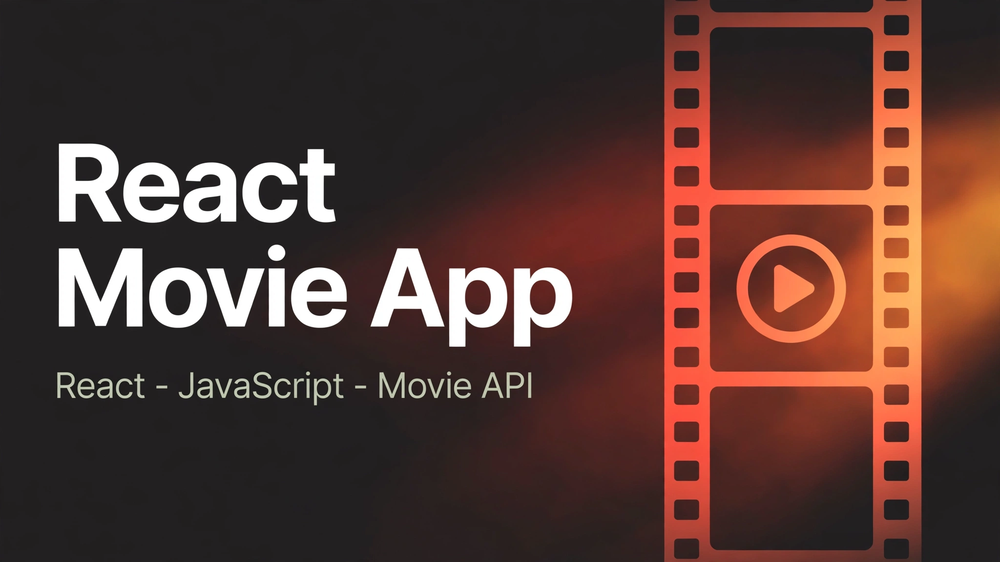
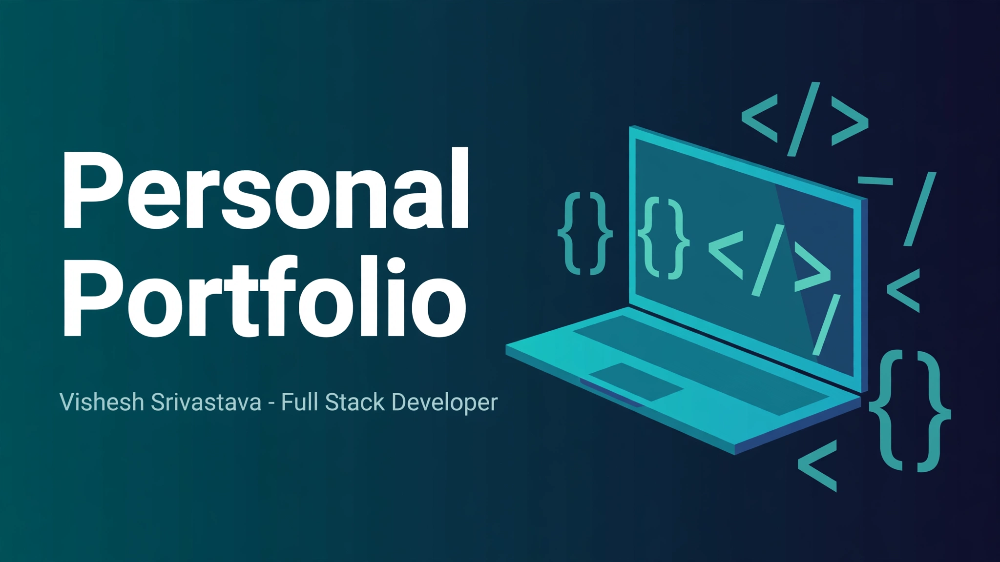

 

## 🙋‍♂️ About Me

- 💼 Web Development Intern at **Thiranex EduTech LLP** (Remote) — building with the MERN stack
- 🎓 B.Tech CSE (2026), Vision Institute of Technology (AKTU)
- ⚡ Solved **60+ DSA problems on LeetCode**
- 🌱 I build fast, responsive, full-stack web apps — from REST APIs to polished UIs
- 📍 Based in Kanpur, India — open to roles in **Delhi NCR, Bengaluru, Hyderabad & Remote**
- 📫 Reach me at **visheshsrivastav15@gmail.com**

## 🛠️ Tech Stack

**Languages & Frontend**

**Backend & Tools**

## 🚀 Featured Projects

<table>
<tr>
<td width="50%" valign="top">

 <b><a href="https://github.com/thevishledger/mern-url-shortener">MERN URL Shortener</a></b>
 Full-stack URL shortener with QR code generation.
 ⚙️ React • Node.js • Express • MongoDB
 🔗 <a href="https://frontend-d1xd.onrender.com"><b>Live Demo</b></a>
</td>
<td width="50%" valign="top">

 <b><a href="https://github.com/thevishledger/Ai-chat-bot">Gemini AI Q&A App</a></b>
 AI chat app powered by the Gemini API — ask questions, get instant answers.
 ⚙️ React • Gemini API • JavaScript
 🔗 <a href="https://ai-chat-bot-eta-six.vercel.app"><b>Live Demo</b></a>
</td>
</tr>
<tr>
<td width="50%" valign="top">

 <b><a href="https://github.com/thevishledger/MY_MOVIE_APP">React Movie App</a></b>
 Movie discovery app with search and rich detail views.
 ⚙️ React • REST API • CSS
 🔗 <a href="https://my-movie-app-qcrs.vercel.app"><b>Live Demo</b></a>
</td>
<td width="50%" valign="top">

 <b><a href="https://github.com/thevishledger/my-portfolio">My Portfolio</a></b>
 My personal portfolio website — projects, skills and contact.
 ⚙️ React • JavaScript • CSS
 🔗 <a href="https://my-portfolio-vishesh.netlify.app"><b>Visit Site</b></a>
</td>
</tr>
</table>

## 📊 GitHub Stats

## 📫 Connect With Me

